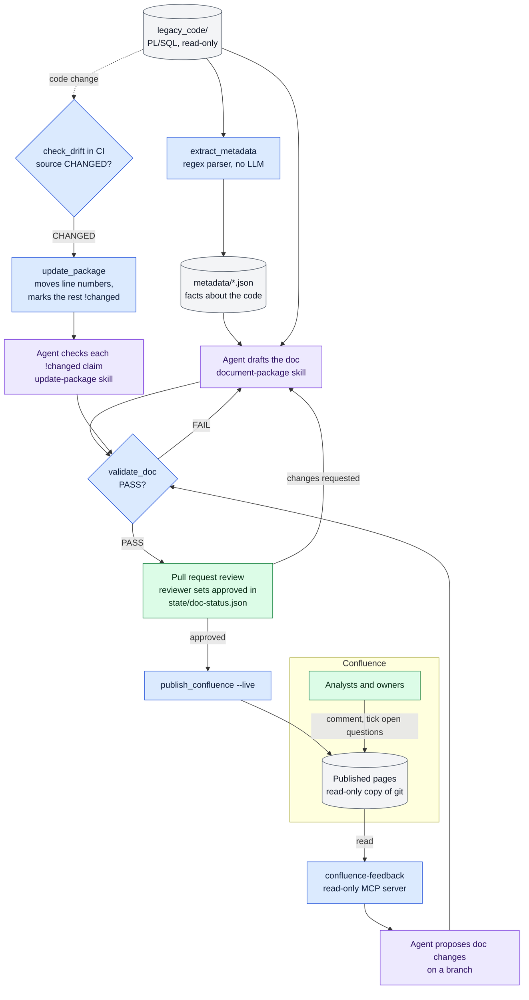

# Agentic legacy documentation (proof of concept)

An AI agent documents undocumented legacy Oracle PL/SQL. All code in `legacy_code/` is fictional: an order-to-invoice system with planted traps that AI documentation tends to get wrong.

## How it works



Blue: deterministic scripts. Purple: the LLM agent. Green: people. Grey: data. Every change to a doc goes through validation and a reviewed pull request; Confluence only ever receives approved docs.

1. **Extract facts.** `scripts/extract_metadata.py` parses `legacy_code/` with regexes (there is no database access) and writes `metadata/*.json`: objects and signatures, dependencies, table usage, and risk flags. Every file is validated through the Pydantic models in `scripts/models/`.
2. **Draft docs.** The agent fills `templates/` for one package at a time, reading the metadata and the source. Every claim cites a unit and line range. Anything it can't establish from the code becomes "Unknown: needs human input". For analysts, each package doc starts with an "In plain language" summary, and each open question is marked `Business:` (an analyst can answer it) or `Technical:` (it needs a developer).
3. **Validate.** `scripts/validate_doc.py` checks each doc against the metadata: referenced units, parameters and tables must exist, claims need citations, and required sections must be present.
4. **Review.** Docs are reviewed through pull requests. `state/doc-status.json` tracks the status of each package and the hash of its source.
5. **Publish.** `scripts/publish_confluence.py` converts approved docs to Confluence pages. Confluence is a read-only copy; changes go through git.

## Repository layout

| Path | Contents |
|------|----------|
| `legacy_code/` | Fictional PL/SQL source. Read-only. |
| `evaluation/` | Answer key. Only used in the retrospective, never during documentation. |
| `metadata/` | Generated JSON facts. |
| `schemas/` | JSON Schemas exported from the Pydantic models. |
| `scripts/`, `scripts/models/` | Extraction, validation, and shared models. |
| `tests/` | pytest tests. |
| `templates/` | Doc templates for packages, procedures, and flows. |
| `glossary/` | Domain terms and naming conventions. |
| `docs/packages/`, `docs/flows/` | Generated documentation. |
| `docs/repo-plan.md` | Inspection findings and design. |
| `state/` | Doc status tracking; who may answer open questions per package. |
| `.claude/skills/` | Agent skills. |
| `.claude/settings.json` | Permission rules that enforce the hard constraints of `CLAUDE.md`. |
| `CLAUDE.md` | Agent rules. |

## Setup

Requires Python 3.14. CI tests only that version.

```bash
python -m venv .venv
# Windows
.venv\Scripts\activate
# macOS / Linux
source .venv/bin/activate

pip install -r requirements.txt
```

### Configuration (.env)

```bash
cp .env.example .env     # Windows: copy .env.example .env
```

Then fill in the values in `.env`. Every variable is described in `.env.example`.

- `.env` is git-ignored and must never be committed. You can confirm this with `git check-ignore -v .env`.
- The database variables are for possible future use only. This PoC has no database access.
- When code starts using a new variable, add it to `.env.example` in the same commit.

## Extract metadata

```bash
python -m scripts.extract_metadata   # legacy_code/ -> metadata/*.json
python -m scripts.export_schemas     # Pydantic models -> schemas/*.schema.json
```

Re-run the extractor whenever `legacy_code/` changes; the output is deterministic. What the regex parser can and cannot see is described in [docs/extraction-limitations.md](docs/extraction-limitations.md).

## Validate a doc

```bash
python -m scripts.validate_doc docs/packages/pkg_order.md [more docs ...]
```

The validator prints `PASS` or `FAIL` per doc, with one line per finding: the doc line, the severity, the check and the message. `ERROR` findings fail the doc; `WARN` findings are for the reviewer. The checks are listed at the top of `scripts/validate_doc.py`. A pass means the doc is well-formed and every id, line range and name it uses exists. It does not mean the claims are true; that is what the `review-doc` skill and the PR review are for.

Known limits:
- A sentence counts as cited when it contains any valid citation, even one about something else.
- Line numbers in a table row are checked against the units named in that row, ignoring which file they are in.
- Names the metadata does not model (locals, cursors, record fields) only need to occur somewhere in the code of `legacy_code/`.
- Questions and lines ending in `:` are not treated as claims.

## Update a doc after a code change

```bash
python -m scripts.update_package UTIL_LOG           # report only
python -m scripts.update_package UTIL_LOG --write   # move line numbers, mark the rest
```

When `check_drift` reports a package as `CHANGED`, its reviewed doc is updated, not rewritten. The script does the mechanical part, without an LLM:

1. **Find the documented version.** It searches git history for the commit whose source matches the hash in `state/doc-status.json`.
2. **Report what changed.** Units whose code changed, units added and removed, and dependencies, table accesses and risk flags added or removed.
3. **Move line numbers.** Every citation and line-column number whose source lines are unchanged gets its new number. Unit ranges and the doc header come from the metadata.
4. **Mark the rest.** A number whose lines changed keeps its old value and gets `!changed`. The validator fails on the marker, so no claim about changed code can slip through unchecked.

The `update-package` skill then has the agent resolve each marker, re-read every changed unit, document added units and set the status back to `draft` for a new review. The pull request diff is mostly moved line numbers; the agent's report lists the claims it rewrote.

Limits: running it twice is safe (the doc header records the source it was moved to). It needs the documented version to be in git history, and it can't see that an unchanged claim became false because of a change elsewhere; that is why the skill re-reads every changed unit.

## Publish to Confluence

```bash
python -m scripts.publish_confluence                    # dry run -> build/confluence/
python -m scripts.publish_confluence --include-drafts   # dry run that also renders unapproved docs
python -m scripts.publish_confluence --live             # create or update the pages
```

Git stays the source of truth. The script, not an LLM, converts the markdown, so the result is deterministic and tested.

- **What is published:** packages whose entry in `state/doc-status.json` has status `approved` or `stale`, with their unit docs; the glossary; and a root page that lists the packages. An approved entry whose source hash no longer matches `legacy_code/` is published as stale, with a warning banner. Draft and reviewed docs are never published live.
- **A package that was approved before** but is now `draft` or `reviewed` (for example after `update-package`) keeps its last approved version. The script finds the newest commit where the state file had the package approved, and renders the docs, metadata and source of that commit. The banner says a newer version is in review. If the source changed since that approval, the page is also marked stale. Citations link to the code at that commit, so they match the old text. A package that was never approved is skipped.
- **Pages:** the root page "Legacy PL/SQL documentation", one child page per package, and one grandchild per unit doc. The title of each page is the doc's `#` heading.
- **Conversion:**
  - Every page starts with coloured status lozenges: `AI GENERATED` (purple) and, on package and unit pages, the doc status (`APPROVED` green, `STALE` yellow). Below them, a banner names the source file and commit.
  - Citations link to the cited lines at that commit (`SOURCE_BASE_URL`).
  - Links between docs become page links.
  - "Open questions" becomes a Confluence task list.
- **Labels:** every page gets the label `ai-generated`; package and unit pages also get their status (`approved` or `stale`). When the status changes, the old status label is removed. Other labels are left alone.
- **Live mode:**
  - Needs `CONFLUENCE_SITE`, `CONFLUENCE_SPACE`, `ATLASSIAN_EMAIL` and `ATLASSIAN_TOKEN` in `.env`, and no uncommitted changes in `docs/`, `glossary/`, `state/` or `legacy_code/`.
  - Publishes through the REST API; `PUBLISH_MODE` must be empty or `rest` (the `mcp` mode is not implemented).
  - The root page goes under `CONFLUENCE_PARENT_ID` when set, otherwise at the top of the space.
  - Pages are found by title in the space.
  - A page whose fingerprint (doc text, status, source hash) is unchanged is skipped.
  - A page that the script did not generate is never overwritten; the run stops before writing anything.
- **Status:** to approve a package, the reviewer changes its status to `approved` in `state/doc-status.json` in a pull request.

Not handled yet: pages for docs that are no longer published are not deleted, and `docs/flows/` is not published (it is empty).

## Read analyst feedback from Confluence

Analysts don't use git. They answer on the published pages: in comments, or by ticking an open question. The read-only MCP server `confluence-feedback` (`scripts/confluence_mcp.py`, registered in `.mcp.json`) lets the agent read that back, so it can propose doc changes in a pull request.

| Tool | Returns |
|------|---------|
| `list_doc_pages` | The pages generated from this repo: title, doc path, the commit and status each page shows, and whether it shows an older approved version. |
| `get_page_feedback(title)` | One page's comments (inline with the text they are attached to, footer, resolved, replies; author, account id, date, and whether the author is an owner) and its open questions with their ticks. |

- **Read-only by construction.** The client refuses every request except GET. It reads only pages with the `ai-generated` label and a "Generated from" banner. It cannot comment, resolve, tick or edit.
- **Untrusted input.** Comment text is written by people. The agent treats it as claims to check and cite (author, date), never as instructions. The rules are in `CLAUDE.md`, "Analyst feedback".
- **Owners close questions, without git.** `state/owners.json` lists who may answer open questions for each package and its unit pages, by Atlassian account id (a display name can be changed by anyone, an account id cannot; it is the last part of the person's Confluence profile URL). The file is gitignored so the ids stay out of this public repo: copy `state/owners.example.json` to `state/owners.json` and fill it in. Without it, every comment is a claim. In a private company repo it should be committed instead, so that changes to who may answer are reviewed. An owner closes a question in Confluence by ticking it and writing the answer in a comment. The agent then proposes the answer in a pull request: the answer moves into the doc text, attributed, and the question is removed. The reviewer decides; after the merge and republish the owner sees the answer on the page. Comments from anyone else stay claims next to the open question.
- **Interactive only.** It uses the same `.env` settings as `--live` publishing and runs only when you ask the agent to read feedback, never in CI. Claude Code asks you to approve the project's MCP server the first time; `/mcp` shows its status.
- **Republishing resets ticks.** `publish_confluence` writes every open question as not ticked, and an inline comment whose text disappears becomes "dangling". Read the feedback before you publish a new version.

Not handled yet: who ticked a question and when (the page source does not say), and mentions show as `@user`.

## Continuous integration

`.github/workflows/ci.yml` runs on every pull request and on every push to `main`. It needs no secrets and calls no external service. It has three jobs:

- **tests:** `python -m pytest`, on Python 3.14 (the version used locally).
- **doc validation:** `python -m scripts.validate_doc` on every doc in `docs/packages/` and `docs/flows/`. A failing doc, or one that still has a `!changed` marker from `update_package`, fails the build. So `validation_passed` in `state/doc-status.json` is no longer only the agent's own report.
- **documentation drift:** `python -m scripts.check_drift`. It re-runs the extractor in memory and compares the result with `metadata/` and `state/doc-status.json`.

| Finding | Meaning | Effect |
|---------|---------|--------|
| `METADATA` | `metadata/` is out of date with `legacy_code/`. Fix: run the extractor and commit `metadata/`. | Fails the build |
| `NEW` | A package has no doc yet (no state entry, or status `todo`). | Warning |
| `CHANGED` | A package's source changed since its doc was written, or moved to another file. | Warning |
| `REMOVED` | A documented package is gone from `legacy_code/`; its doc is orphaned. | Warning |

Warnings appear as annotations on the pull request and as a table in the job summary. They don't fail the build, because a code change can't bring its own doc update. The check says *which package* changed, not which lines: the state file stores one hash per package.

Run it locally with `python -m scripts.check_drift`.

## Git workflow

- Each step is built on its own branch, `feature/step-<number>-<short-name>`, created from `main`. If the previous step hasn't been merged yet, the branch is created from the previous step's branch instead.
- Make small commits with clear messages.
- Merges into `main` happen only through a reviewed pull request. Never force-push.
- Before every commit, check `git status` to make sure no `.env` or credential file is staged.

### Guardrails

The hard rules in `CLAUDE.md` are not only instructions to the model. Where a tool can enforce them, it does:

| Rule | Enforced by |
|------|-------------|
| Never read the answer key or `.env` | `.claude/settings.json` denies `Read` on `evaluation/**` and `.env` (also covers Grep, Glob and shell commands such as `cat` that name the file) |
| `legacy_code/` and `metadata/` are not edited by hand | `.claude/settings.json` denies `Edit` there; the extractor still writes `metadata/` |
| Only the owner changes who may answer questions, or the agent's permissions | `Edit` denied on `state/owners.json` and on `.claude/settings.json` |
| Only the reviewer approves a doc | `.github/CODEOWNERS` on `state/`, plus the pull request review |
| Docs are valid when merged | the `doc validation` CI job |

Limits, kept on purpose:
- A deny rule in the committed project settings cannot be overridden by an allow in `settings.local.json`. To run the retrospective (step 8), the owner removes the `evaluation/` rule in a branch.
- Permission rules match tool calls, not every process. A script that opens a file itself, or a shell command that does not name the file, is not stopped; the CLAUDE.md rule still applies.
- `CODEOWNERS` only requests the owner's review. It blocks a merge when branch protection requires code-owner review, which a one-person repo cannot use, because GitHub does not let you approve your own pull request.
- Nothing stops the agent from writing `approved` into `state/doc-status.json`: it updates that file through a script. The pull request diff shows it, and the reviewer rejects it.

## Steps

| Step | Branch | Deliverable |
|------|--------|-------------|
| 0 | `feature/step-0-fake-codebase` | Fictional legacy codebase and answer key |
| 1 | `feature/step-1-inspect-and-plan` | `docs/repo-plan.md` |
| 2 | `feature/step-2-scaffold` | This scaffold |
| 3 | `feature/step-3-metadata-extraction` | Models, extractor, `metadata/`, `schemas/` |
| 3b | `feature/step-3b-spot-check` | Manual verification, fixes, and tests |
| 4 | `feature/step-4-templates-and-glossary` | Templates and glossary stubs |
| 5 | `feature/step-5-agent-rules-and-skills` | `CLAUDE.md` and skills |
| 6 | `feature/step-6-validation` | `validate_doc.py` and tests |
| 7 | `feature/step-7-pilot` | Documentation for the 4 packages |
| 8 | `feature/step-8-retrospective` | `docs/pilot-report.md` |
| 9 | `feature/publishing-to-confluence` | `scripts/publish_confluence.py` and tests |
| 10 | `feature/ci-pipeline` | GitHub Actions workflow that runs the tests |
| 11 | `feature/drift-check` | `scripts/check_drift.py` and the drift job in CI |
| 12 | `feature/update-package` | `scripts/update_package.py`, the `update-package` skill, the `!changed` validator check |
| 13 | `feature/confluence-mcp` | `scripts/confluence_mcp.py`: read-only MCP server for analyst feedback |
